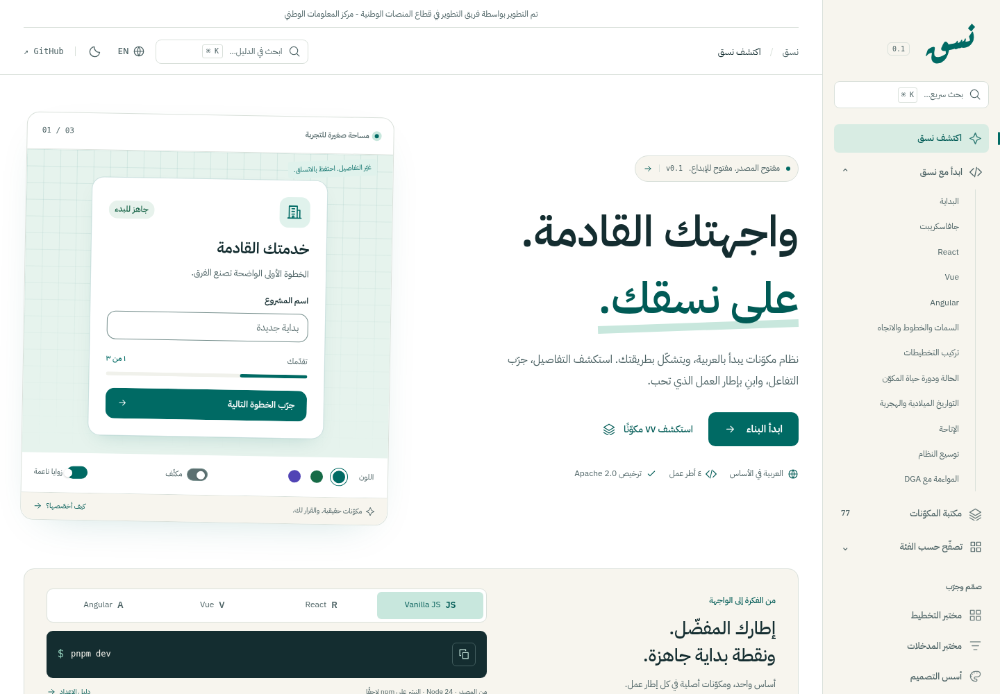

# Nasaq — نسق

**An Arabic-first, extensible UI system for vanilla JavaScript, React, Vue, and Angular.** Nasaq gives products an independent visual identity, shared behavior, and editable patterns for complete service journeys.

Developed by the Development Team in the National Platforms Sector — National Information Center.

تم التطوير بواسطة فريق التطوير في قطاع المنصات الوطنية - مركز المعلومات الوطني

[Guide & live examples](https://mohamedembarak.github.io/nasaq/) · [العربية](README.ar.md) · [Coverage](docs/coverage.md) · [Architecture](docs/architecture.md) · [Extension guide](docs/extension.md) · [Validation](docs/validation.md) · [AI guide](llms.txt)

The **Woven Rhythm** identity uses teal and warm ivory with an Arabic-only **نسق** wordmark. Its **Aref Ruqaa Bold lettering is exported as SVG paths**, with no font dependency to display the logo. Interface typography remains IBM Plex Sans Arabic and IBM Plex Sans. The [brand guide](brand/index-en.html), [artwork guidance](brand/README.md), and [brand kit ZIP](brand/nasaq-brand-kit.zip) include the wordmark and transparent loaders that animate its lettering.



Preview the [live editor in Arabic](docs/previews/component-editor-ar-dark.png), [layout studio](docs/previews/layouts.png) and [Gregorian/Umm al-Qura date picker](docs/previews/date-picker.png).

Nasaq draws on **DGA Platforms Code**, the **Unified Design System** for the **Kingdom of Saudi Arabia (KSA)** — **كود المنصات، نظام التصميم الموحد، هيئة الحكومة الرقمية** — for relevant foundations and government service conventions. It adds its own design, components, and compositions. **DGA compliance is tracked as evidence and gaps; Nasaq is an independent implementation, with no claim of official endorsement or certification.** Read [DGA alignment](docs/alignment.md) before describing a product as compliant.

## Development status

Nasaq is an **Apache 2.0 public source preview, version 0.1**. Seven packages support a **77-entry component catalog** across vanilla, React, Vue, and Angular: forms, interaction, content, Saudi service patterns, and 12 layout primitives. The package scope is provisional. Nothing here is published on npm, and a source directory or a working demo does not establish production readiness.

The [roadmap](docs/roadmap.md) separates planned scope, implemented work, and verified behavior. [components.json](components.json) provides the same distinctions in a form that tools and coding assistants can read. Exact framework coverage and verification must be checked there rather than inferred from the package names.

The guide opens in Arabic, with a persistent English switch and keyboard search (Ctrl/Cmd + K). Every component includes Preview, Code, and Playground tabs. The playground offers editable HTML, CSS, and JavaScript, a live isolated preview, console errors, and reset controls. It uses the local vanilla implementation; framework-specific setup and API guidance remain in their respective articles. External imports are unsupported in the embedded preview. [Editor license notices](https://mohamedembarak.github.io/nasaq/licenses/editor.txt) accompany the deployed guide.

## What the system is designed to provide

- A coherent Nasaq theme, an optional DGA reference theme, and explicit custom-theme overrides.
- Arabic and English content, independent locale and text direction, and logical CSS for RTL/LTR layouts.
- Native component APIs in each framework, built on shared tokens, styles, and behavior helpers.
- Vanilla HTML/CSS that remains useful without JavaScript, with explicit enhancement for interactive controls.
- Reusable primitives, editable blocks, and full service discovery, application, review, and request-management examples.
- A lab for all 22 native HTML input types, Saudi input recipes, and responsive layout composition.
- Gregorian and Umm al-Qura Calendar/DatePicker controls with explicit date-only values and a documented reference dataset.
- Public extension points, understandable source, typed APIs, and concise documentation for human and AI-assisted development.

## Package map

| Package | Responsibility |
|---|---|
| `@nasaq/tokens` | Design values and semantic theme variables |
| `@nasaq/styles` | Component CSS, layout helpers, and a separately imported reset |
| `@nasaq/core` | Framework-independent behavior and internationalization helpers |
| `@nasaq/vanilla` | HTML enhancement controllers with cleanup |
| `@nasaq/react` | React components using the shared foundation |
| `@nasaq/vue` | Vue components using the shared foundation |
| `@nasaq/angular` | Angular components using the shared foundation |

Package manifests retain `private: true` until an npm release is explicitly prepared; the source and guide are public. Framework dependencies belong to the relevant adapter; the core does not depend on a framework runtime.

## Run locally

Clone the source, then use the pnpm version pinned in `package.json`. The development checks ran with Node.js `24.19.0` and pnpm `11.25.0`:

```sh
git clone https://github.com/MohamedEmbarak/nasaq.git
cd nasaq
corepack enable
pnpm install --frozen-lockfile
pnpm build:packages
pnpm dev
```

The development entry point is the vanilla playground. Explore `#components` for the catalog, `#inputs` for input semantics, and `#layouts` for layout composition. The local brand guide is included. To run a native framework example after building packages:

```sh
pnpm --filter @nasaq/example-react dev
pnpm --filter @nasaq/example-vue dev
pnpm --filter @nasaq/example-angular dev
```

Choose the example you need; each command starts a separate development server. Available checks are `pnpm build`, `pnpm typecheck:playground`, `pnpm test`, `pnpm test:browser`, and `pnpm check:packages`. See the [validation record](docs/validation.md) for results and browser setup. API guides: [vanilla](packages/vanilla/README.md), [React](packages/react/README.md), [Vue](packages/vue/README.md), and [Angular](packages/angular/README.md).

## Start with HTML and CSS

The shared styling contract uses ordinary HTML, `nq-` classes, and `--nq-` custom properties:

```html
<section lang="ar" dir="rtl" data-nq-theme="nasaq"
         data-nq-mode="light" data-nq-density="comfortable">
  <div class="nq-card">
    <div class="nq-card-body">
      <h2>طلب جديد</h2>
      <p>راجع متطلبات الخدمة قبل البدء.</p>
      <button class="nq-button" data-variant="primary" type="button">
        ابدأ الطلب
      </button>
    </div>
  </div>
</section>
```

Load the styles through the consuming application's package setup:

```ts
import '@nasaq/styles/styles.css';
```

The reset is optional; import `@nasaq/styles/reset.css` before the component stylesheet if the application needs it. The [behavior contract](packages/core/API.md) and [vanilla expansion guide](packages/vanilla/EXPANSION-API.md) document enhancement APIs and markup. A framework adapter owns its rendered DOM; do not run vanilla enhancement over React, Vue, or Angular component trees.

The React adapter uses ordinary controlled inputs:

```tsx
import { useState } from 'react';
import { TextField } from '@nasaq/react';
import '@nasaq/styles/styles.css';

export function RequestName() {
  const [name, setName] = useState('');
  return <TextField label="اسم الطلب" value={name}
    onChange={event => setName(event.currentTarget.value)} />;
}
```

Set `lang` and `dir` on the application container, and load the fonts appropriate to the product. Styles declare font families; consumers control font loading.

## Modify and extend

Use a theme override for visual changes, a documented variant for component appearance, and composition for application-specific behavior. Start from an [editable block](blocks/README.md), or run `pnpm new:component request-summary` to generate a new application-owned block. This command scaffolds HTML, CSS, and guidance under `blocks/`; it does not generate a new framework library primitive. [The extension guide](docs/extension.md) explains the boundaries and contribution workflow.

For coding assistants, begin with [AGENTS.md](AGENTS.md), [CONTRACT.md](CONTRACT.md), [EXPANSION.md](EXPANSION.md), [llms.txt](llms.txt), and the catalog. Generate code against actual exports and examples, and retain labels, keyboard behavior, error messages, and direction support when customizing.

## Current boundaries

Combobox is local and single-select; MultiSelect is a separate searchable checkbox list. DataTable supports stable localized sorting; virtualization and editing need a specialist engine. FileUpload/FileDropzone select files; transport and storage belong to the application. Phone, IBAN, and national-identifier recipes collect data without claiming identity or account verification. [Coverage](docs/coverage.md) defines the component and input scope; [integrations](docs/integrations.md) explains maps, charts, editors, authentication, and payment boundaries.

Calendar/DatePicker store Gregorian ISO `YYYY-MM-DD` values and can display Gregorian or Umm al-Qura dates. Hijri conversion uses a pinned reference table with explicit limits. Read [calendar reliability](docs/date-calendars.md) before using derived dates in official records. The examples use fictional data and simulate service submission and request tracking.

Shared behavior uses project-owned headless helpers and a small combobox reducer; there is no Zag dependency. Angular ships as an Angular Package Format library. Its Vite example deliberately uses JIT and does not establish production AOT, SSR, or hydration coverage. See [architecture](docs/architecture.md) and the [Angular guide](packages/angular/README.md).

## Quality and release

The intended accessibility target is **WCAG 2.2 AA**. Release evaluation includes keyboard, assistive-technology, contrast, and reduced-motion checks. This target is not a blanket claim that every example has passed an audit. Framework parity, package-consumer builds, and real journey tests form the release gates in the [roadmap](docs/roadmap.md).

The [validation record](docs/validation.md) identifies the tested snapshot, exact commands, package-consumer checks, targeted behavior/hydration cases, and Chromium journeys. The [catalog](components.json) separates implementation from per-component verification; baseline checks do not automatically verify later additions. Manual screen-reader testing and cross-browser coverage remain open.

Source is available at [MohamedEmbarak/nasaq](https://github.com/MohamedEmbarak/nasaq). The [guide and live examples](https://mohamedembarak.github.io/nasaq/) deploy to GitHub Pages. npm packages are not published yet; use the workspace or locally packed packages as explained in the guide. See [release preparation](docs/publication.md).

## License

Nasaq source is licensed under [Apache 2.0](LICENSE). See [NOTICE](NOTICE) for attribution and the bundled notices for third-party fonts and calendar data. The license does not grant trademark rights or DGA endorsement.
