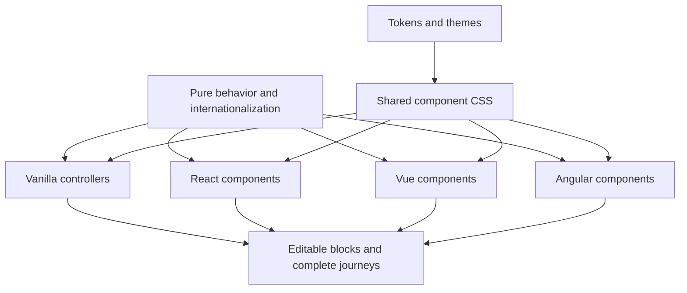

# Architecture

Nasaq has a shared foundation and native framework renderers. Vanilla comes first as the reference for HTML semantics and interaction, while React, Vue, and Angular reuse the foundation through their own component models.

The implementation has seven packages and a 77-entry catalog across four adapters. This scope includes native controls, interactive components, content/service compositions, and 12 CSS layout primitives. The [coverage guide](coverage.md) distinguishes these from native input aliases and external integration recipes. Source presence and verification remain separate in the catalog.



## Package boundaries

| Package | Owns | Boundary |
|---|---|---|
| `@nasaq/tokens` | Design values, theme variables, token metadata | No rendering or interaction |
| `@nasaq/styles` | CSS recipes, states, density, layout helpers, optional reset | No framework runtime or application data |
| `@nasaq/core` | Search, navigation, form helpers, stable sorting, responsive layout variables, number/date formatting and calendar arithmetic | No framework runtime; no browser globals at module evaluation |
| `@nasaq/vanilla` | Explicit enhancement and cleanup of consumer-owned HTML | Owns only the elements it enhances |
| Framework adapters | Native rendering, events, refs, state, lifecycle, and framework form integration | Do not mount imperative vanilla renderers into framework-owned DOM |
| Examples and blocks | Composition, sample data, navigation, and task-specific behavior | Consume public package contracts |

The workspace uses TypeScript 6 and pnpm. Packages use ESM and explicit exports. Angular is built with `ng-packagr` as an Angular Package Format library using partial compilation; a production Angular application links it through its normal AOT build. Framework peers remain external. The exact supported framework/runtime versions are defined by package manifests and verified consumer builds.

The Angular example uses Vite and deliberately loads `@angular/compiler` for JIT. It exercises a real consumer of the built library, but it does not prove a production Angular CLI build, server rendering, or hydration. Keep those claims separate.

## Styling contract

Public component classes use the `nq-` prefix; design variables use `--nq-`. Component styles are scoped to their classes. A separately imported reset allows existing applications to adopt Nasaq incrementally.

Theme, color mode, density, direction, and locale are separate axes:

```html
<main data-nq-theme="nasaq"
      data-nq-mode="light"
      data-nq-density="comfortable"
      lang="ar" dir="rtl">
  <!-- Components -->
</main>
```

The intended theme values are `nasaq`, `dga`, and `custom`; mode values are `light` and `dark`; density values are `comfortable` and `compact`. A selector expresses configuration, not verified coverage of every possible combination. Maintain a tested configuration matrix.

## Behavior and DOM ownership

Core helpers calculate shared results such as filtered options or the next enabled item. Framework adapters retain responsibility for their lifecycle and event model. DOM utilities may be called deliberately, but the core does not render over a framework's elements.

The implementation uses project-owned headless utilities and a small pure combobox reducer. There is no Zag dependency or general state-machine runtime. This choice keeps the current behavior surface explicit and editable, while making Nasaq responsible for its interaction correctness and cross-adapter tests. A future engine change would need an explicit compatibility and maintenance decision.

Vanilla uses `data-nq` markers and `enhance(root)`, which returns cleanup. Consumers can use individual controllers when they want explicit ownership. Initialization, updates, repeated mounting, and cleanup must not create duplicate listeners or stale state. Static HTML and native elements remain usable without enhancement where their semantics allow it.

## Forms and state

Public controls must distinguish user actions from external value updates. Shared behavior should not assume a particular form library. Each adapter documents its value/change contract, validation, disabled state, focus access, and integration with native or framework forms. SSR-safe imports, stable identifiers, and hydration behavior are separate verification concerns.

React inputs preserve native input props and events. Angular form controls implement `ControlValueAccessor` and also expose a value/change interface; pass application-owned stable control identifiers for server-rendered forms. Consult each adapter's implementation and examples for the supported API instead of translating props mechanically between frameworks.

## Internationalization

The core uses `Intl` for general number and timestamp formatting with explicit locale, calendar, numbering system, and time-zone options. Direction is supplied separately from locale. Consumers own translations and domain copy; components provide clear places to supply accessible text.

```ts
import { formatDate, formatNumber } from '@nasaq/core';

formatNumber(1250, { locale: 'ar-SA', numberingSystem: 'arab' });
formatDate('2026-10-28T09:00:00+03:00', {
  locale: 'ar-SA',
  calendar: 'islamic-umalqura',
  timeZone: 'Asia/Riyadh',
  dateStyle: 'long',
});
```

For instants, use date strings with an explicit offset. The general `formatDate` helper uses host `Intl` data; it is not the canonical converter for a persisted dual-calendar record.

Calendar and DatePicker use Gregorian ISO `YYYY-MM-DD` values with independent `gregory` or `islamic-umalqura` display. Calendar arithmetic uses pinned `@internationalized/date` with Nasaq's table-backed Umm al-Qura provider. The pinned HijriDate reference data, supported range, conversion checks, and unresolved official-source questions are documented in [calendar reliability](date-calendars.md). Date-only values are never inferred by applying a manual Hijri day offset or round-tripping through local-midnight timestamps.

## Responsive layout

The 12 layout primitives share the pure `layoutStyles` helper. It maps spacing, alignment, columns, and sizing props to `--nq-layout-*` variables. Shared CSS resolves responsive `base`, `sm`, `md`, `lg`, and `xl` values at 40, 48, 64, and 80 rem breakpoints. No JavaScript viewport measurement is required, so the same layout configuration works during server rendering and in vanilla HTML. Read the [styles API](../packages/styles/README.md) for exact props and examples.

## Specialist engines and services

Nasaq owns surrounding forms, navigation, layout, and feedback. Maps, charts, rich/code editors, PDF rendering, identity verification, payments, and upload transport belong to application-selected engines or services. The [integration guide](integrations.md) defines rendering ownership, cleanup, and acceptance checks. DataTable sorting, file selection, or a national-identifier input is not a replacement for those integrations.

## Blocks, journeys, and brand assets

The [blocks directory](../blocks/README.md) contains editable HTML compositions for a service card, an application section, and a request timeline. `pnpm new:component <kebab-case-name>` creates another block directory with HTML, CSS, and guidance; it does not register a new library component or create adapters.

The vanilla playground and framework examples own their fictional service data, journey state, and simulated submission. Backend authentication, persistence, uploads, and real service integration belong to consuming applications. The [brand kit](../brand/README.md) supplies artwork and identity guidance. Original project code, documentation, and artwork follow the root Apache-2.0 license; bundled font software retains its upstream notices.

## Public and private surfaces

The public surface comprises package exports, documented types, component props/events, supported CSS classes and variables, documented state attributes, and controller lifecycle APIs. Internal file paths and undocumented DOM structure are not extension contracts. [CONTRACT.md](../CONTRACT.md) and [EXPANSION.md](../EXPANSION.md) coordinate the scope; the [core API](../packages/core/API.md), [vanilla expansion markup](../packages/vanilla/EXPANSION-API.md), actual exports, and examples provide concrete usage contracts.

## Compatibility strategy

Behavior tests cover keyboard and state transitions; consumer builds cover exported packages and framework integration; browser tests cover rendered interaction and journeys. Visual comparisons protect deliberate design choices. API changes require an explicit compatibility decision and migration notes. The initial `0.1` phase is a source preview, so stability must be demonstrated before publishing a stable promise.
